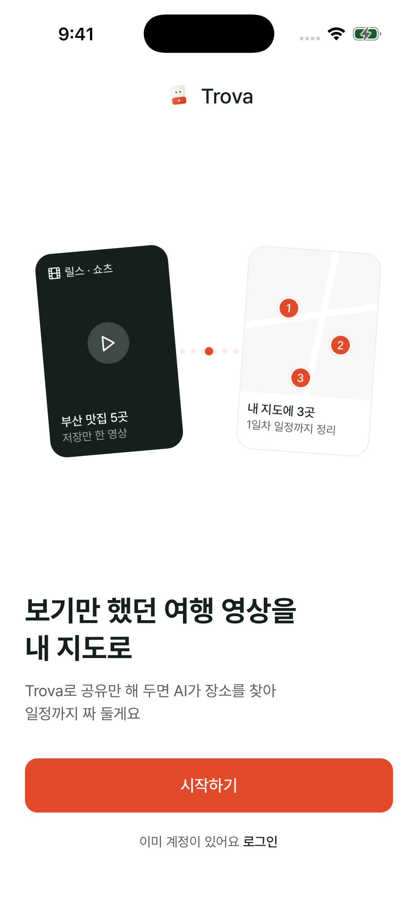
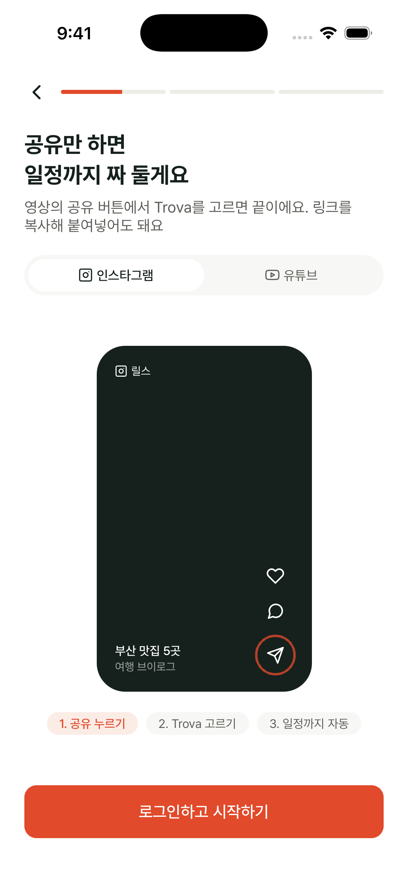
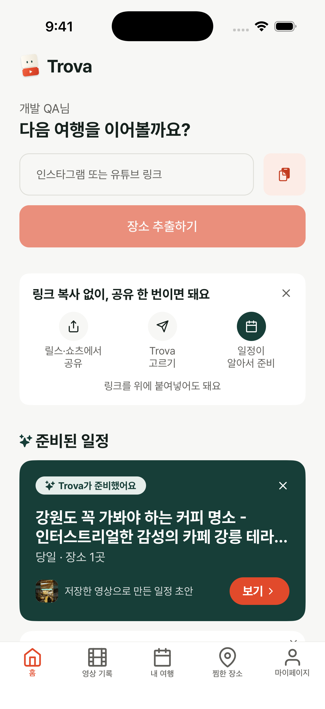
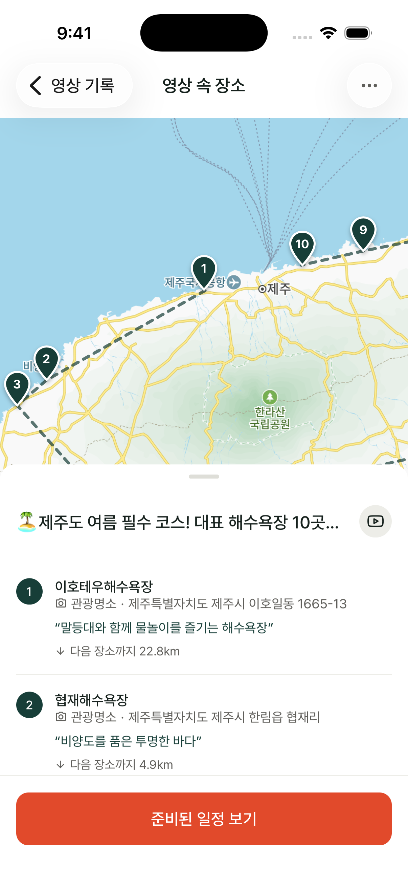
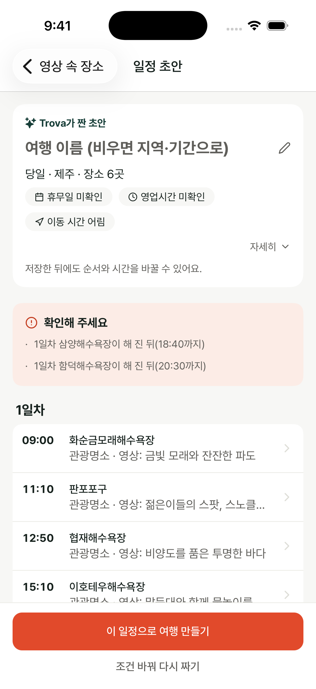
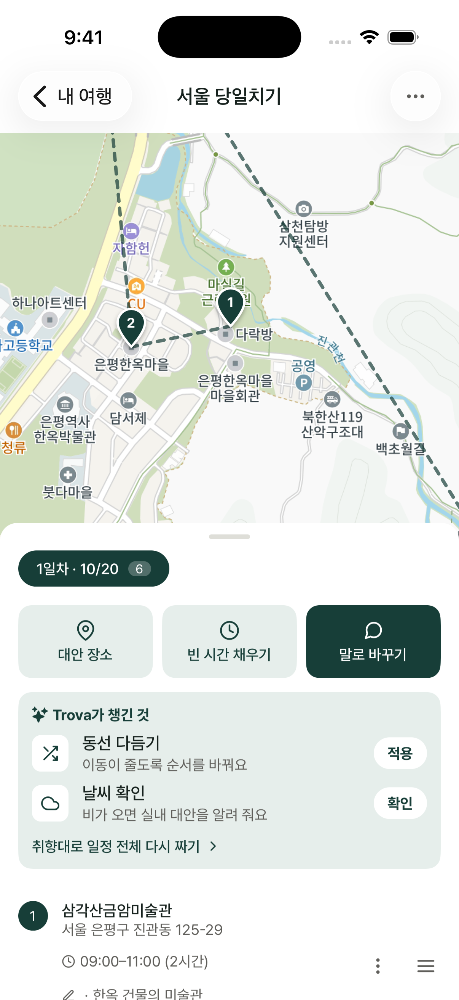
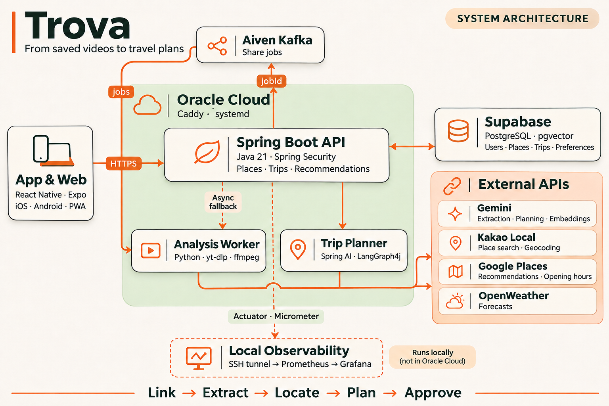

# Trova

### 보기만 했던 여행 영상을, 내 여행으로

인스타그램·유튜브에서 발견한 장소를 지도에 모으고, 
AI가 준비한 일정으로 나만의 여행을 시작하세요.

  
  
  

**링크 공유 &nbsp; → &nbsp; 장소 발견 &nbsp; → &nbsp; 일정 초안 &nbsp; → &nbsp; 나의 여행**

---

## 저장만 해 둔 여행, 이제 떠나볼까요?

릴스에서 본 맛집, 쇼츠에서 발견한 바다. 나중에 가려고 저장했지만, 여행을 준비할 때면 영상을 다시 보며 장소를 검색하고 동선을 짜야 합니다.

**Trova는 그 사이를 연결합니다.** 링크를 공유하면 AI가 콘텐츠 속 장소를 찾아 지도에 정리하고 일정 초안까지 준비합니다. 마음에 드는 초안을 여행으로 저장하고, 방문 순서와 시간을 바꾸며 계획을 완성하세요.

 

## Meet Trova

<table>
  <tr>
    <th align="center" width="33%">01 · 발견의 시작</th>
    <th align="center" width="33%">02 · 공유 한 번으로</th>
    <th align="center" width="33%">03 · 준비된 일정</th>
  </tr>
  <tr>
    <td align="center"></td>
    <td align="center"></td>
    <td align="center"></td>
  </tr>
  <tr>
    <td align="center">저장했던 영상을 여행의 시작으로</td>
    <td align="center">영상 링크를 공유하면 장소와 일정이 차곡차곡</td>
    <td align="center">앱을 다시 열면 일정 초안이 기다려요</td>
  </tr>
</table>

<table>
  <tr>
    <th align="center" width="33%">04 · 영상 속 장소를 지도에</th>
    <th align="center" width="33%">05 · AI가 짜 둔 초안</th>
    <th align="center" width="33%">06 · 나만의 여행으로</th>
  </tr>
  <tr>
    <td align="center"></td>
    <td align="center"></td>
    <td align="center"></td>
  </tr>
  <tr>
    <td align="center">장소를 하나씩 검색하는 대신 지도에서 한눈에 확인</td>
    <td align="center">방문 순서와 시간을 확인하고 마음에 들면 여행으로 저장</td>
    <td align="center">순서·시간을 바꾸고 내게 맞는 동선으로 완성</td>
  </tr>
</table>

2026.11.05 · iPhone 17 Pro 시뮬레이터에서 직접 촬영한 앱 화면 · 테스트 계정 사용

 

## 여행을 준비하는 방법

| | Trova가 도와주는 일 |
| :--- | :--- |
| **장소 모으기** | 인스타그램 릴스·사진 게시물, 유튜브 영상·쇼츠에서 장소를 찾아 지도에 정리합니다. 찜과 폴더로 가고 싶은 곳을 모을 수 있습니다. |
| **일정 만들기** | 영상 속 장소로 일정 초안을 자동으로 준비합니다. 여러 영상의 장소를 모아 원하는 조건으로 다시 만들 수도 있습니다. |
| **계획 다듬기** | 초안을 승인해 여행으로 저장하고, 방문 순서·시간을 편집하거나 동선을 최적화합니다. |
| **여행 중 바꾸기** | 대체 장소와 빈 시간에 갈 곳을 추천받고, 대화형 비서에게 취향을 전달합니다. 비 소식에 맞춰 실내 대안을 찾거나 일정을 재구성할 수 있습니다. |

 

## Under the hood

  

핵심 백엔드 처리와 운영 구성을 나타낸 개념도입니다. 이미지를 누르면 크게 볼 수 있습니다.

### 콘텐츠에서 실제 장소로

Gemini에 영상 링크나 음성·화면 프레임·사진·설명을 전달해 장소를 추출합니다. 카카오 로컬 검색으로 위치 후보를 찾고, 모호한 후보는 추가 선택·검증을 거칩니다. 플랫폼에 따라 입력 방식을 나누고, 영상 처리에는 Python·yt-dlp·ffmpeg를 사용합니다.

### 오래 걸리는 분석은 비동기로

Spring Boot API가 작업을 접수하면 Aiven Kafka를 통해 분석을 실행합니다. Kafka 전송에 실패하면 내부 실행기로 넘기며, 중복 제출·중복 실행을 억제합니다. 분석 결과 저장과 완료 상태 변경은 하나의 트랜잭션으로 처리합니다.

### AI 초안을 코드로 검증하기

LangGraph4j로 **생성 → 코드 보정 → 규칙 검증 → AI 수정** 흐름을 구성했습니다. AI 수정은 최대 두 번 수행하고 검증 오류가 가장 적은 초안을 선택합니다. 실제 여행 저장은 사용자가 승인한 뒤에 진행합니다.

### 여행에 맞는 추천과 동선

pgvector로 사용자 취향 신호를 검색해 추천 순위에 반영합니다. 대화형 비서는 도구 호출로 대체 장소와 빈 시간 추천을 수행합니다. 동선 최적화에는 장소 10개 이하에서 Held–Karp 동적 계획법을, 그보다 많을 때는 근사 방식을 사용합니다.

### 운영하며 관찰하고 개선하기

Oracle Cloud의 단일 서버에서 Caddy·systemd로 운영합니다. 분석 단계, 외부 API 호출, 큐 대기와 JVM 자원을 Micrometer로 계측하고, 로컬 Prometheus·Grafana가 SSH 터널을 통해 수집합니다.

 

## Built with

| App & Web | Backend | AI & Data | Infrastructure |
| :--- | :--- | :--- | :--- |
| React Native · Expo | Java 21 · Spring Boot | Gemini · Spring AI | Oracle Cloud · Caddy |
| TypeScript · TanStack Query | Spring Security · JPA | Python · yt-dlp · ffmpeg | systemd · Aiven Kafka |
| Kakao Maps · PWA | LangGraph4j | PostgreSQL · pgvector | Prometheus · Grafana |

 

## Our repositories

| 저장소 | 역할 |
| :--- | :--- |
| [trova-app](https://github.com/Trovapp/trova-app) | React Native·Expo 기반 앱과 웹/PWA |
| [trova-backend](https://github.com/Trovapp/trova-backend) | API 서버 · AI 분석 · 일정 생성 · 추천 |
| [trova-frontend](https://github.com/Trovapp/trova-frontend) | 별도 웹 프론트엔드 |
| [trovapp.github.io](https://github.com/Trovapp/trovapp.github.io) | 개인정보처리방침 · 이용약관 · 이용 안내 |
| [Trovapp](https://github.com/Trovapp/Trovapp) | 서비스 소개 바로가기 |

일부 코드 저장소는 비공개로 운영합니다.

---

**저장한 순간부터, 떠나는 순간까지. Trova.**

[서비스 이용하기](https://app.trovapp.workers.dev) &nbsp; · &nbsp; [개인정보처리방침](https://trovapp.github.io/privacy/) &nbsp; · &nbsp; [이용약관](https://trovapp.github.io/terms/)

